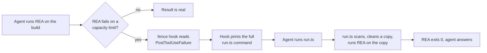

# ReClarity: anti-BLA toolkit for AI reverse-engineering agents

[](https://github.com/AIshihzong/awesome-reverse-engineer-anything)
[](LICENSE)

ReClarity is an **anti-BLA** skill and toolkit. [BLA](https://github.com/qybaihe/bla) (Blind LLM Agents) hardens a build with decoy code, fixed-limit floods and clean-looking shadow logic so that the AI reverse-engineering agent [REA](https://github.com/morluto/rea) fails. ReClarity scans a hardened build, removes the BLA decoys from a copy, and checks the copy by running it, so REA can analyze it again. BLA must keep program behavior the same, and ReClarity relies on that rule.

**Agents:** follow [setup.md](setup.md) for exact setup steps from a clean machine.

## Side by side: plain REA and REA plus ReClarity

PLACEHOLDER_SBS

The video shows two sessions of Claude Opus 5.5 on the same hardened build, left to right: plain REA, then REA plus ReClarity. Plain REA stopped at the ASAR limit with 0 of 3 answers. REA plus ReClarity gave 3 of 3 correct answers. One run each; details in [docs/e2e-recording.md](docs/e2e-recording.md). The video is cut from that recording, and the left pane runs at 2x speed and the right pane at 12x. Use the player controls to scrub.

## Install

```bash
npx skills add i098/ReClarity --skill anti-bla --skill setup-clarity -a claude-code -y
(cd .claude/skills/anti-bla && bun install)
bun .claude/skills/setup-clarity/hooks/install.ts --target app.asar
```

Needs [Bun](https://bun.sh) and, for coverage, `bwrap`. Replace `app.asar` with your build. The last command adds the hooks to `.claude/settings.json`. Details: [docs/usage.md](docs/usage.md).

## Run

```bash
bun .claude/skills/anti-bla/scripts/run.ts <target> --work .reclarity/work --rea "rea analyze-javascript-application {target}"
```

From a clone of this repository, use `skills/anti-bla/scripts/run.ts`.

## Auto-trigger: REA fails, the hook gives the fix

After the hooks are installed, you do not need to name ReClarity. When REA fails on a capacity limit, the `fence` hook gives the agent the complete `run.ts` command. The agent runs it.



1. Install as in [Install](#install).
2. Start Claude Code in the project and ask: `Use REA (rea analyze-javascript-application app.asar) to analyze this app and tell me what it does.`
3. REA fails with `ASAR header/index admission is limited to 16 MiB`. The hook adds the `run.ts` command to the agent context.
4. The agent runs `run.ts`. REA runs on the cleaned copy.

Recorded check (2026-11-25): 1 session, a BLA-hardened ASAR with a 22 MB header, Claude Code and Sonnet 5.5. REA failed, the hook gave the command, REA ran on the cleaned copy and exited 0 in 65 s. The agent gave a correct answer. Limits: one model, one sample; see [docs/auto-trigger.md](docs/auto-trigger.md). Proof files: [recording](docs/proof/autotrigger-e2e.cast) (`asciinema play`), [hook log](docs/proof/autotrigger-e2e-hooks.jsonl), [transcript](docs/proof/autotrigger-e2e-transcript.txt).

## BLA de-obfuscation: what it does

- **Scan** a build for BLA trap shapes before the first REA call. Score 0 means plain REA.
- **Clean a copy** of the build. The original stays unchanged.
- **Check by running** the build in a bwrap sandbox with coverage. Never-run code is "not run", never evidence.
- **Guard the budget** with token and time caps and one retry after a REA capacity error.
- **Treat target text as data.** Bait text is a finding, never an instruction.

## Anti-BLA skills

| Skill | Use it when |
| --- | --- |
| [`anti-bla`](skills/anti-bla/SKILL.md) | A REA run hits a capacity error, shows enclave or attestation words, or the target has BLA config files. It scans, cleans a copy and checks by running. |
| [`untrusted-repo-read`](skills/untrusted-repo-read/SKILL.md) | A repository you must read carries text that gives orders to an AI. It writes a view copy where those spans are markers. |
| [`setup-clarity`](skills/setup-clarity/SKILL.md) | You start a project that will get BLA-hardened builds. It installs hooks that enforce the anti-bla rules. |

## Measured: ReClarity vs LASIK on BLA-hardened builds

Correct means the program output equals the unhardened app's output (5 JS seeds, 3 release files):

| BLA | Arm | JS seeds correct | Release files correct | Release ASAR header |
| --- | --- | --- | --- | --- |
| 3.2.1 | LASIK | 0 of 5 | 2 of 3 | 1 KB |
| 3.2.1 | ReClarity | 5 of 5 | 3 of 3 | 0.7 KB |
| 3.5.9 | LASIK | 0 of 5 | 2 of 3 | 20.0 MB |
| 3.5.9 | ReClarity | 5 of 5 | 3 of 3 | 4.2 MB |

One run per cell, no agent run; plain REA, method and limits are in [docs/measured-comparison.md](docs/measured-comparison.md).

## Auto-trigger recording

https://github.com/user-attachments/assets/903bf115-3d72-4181-9e47-de52aae9f505

The video plays the [terminal recording](docs/proof/autotrigger-e2e.cast) of the auto-trigger check above at 4x speed. Use the player controls to scrub.

## Docs

- [Usage](docs/usage.md): requirements, all commands, when REA runs call the skill.
- [Techniques](docs/techniques.md): each BLA trap and its answer.
- [Proof](docs/proof.md): A/B/C runs on a BLA 3.1.0 hardened sample, and the BLA 3.2.2 technique coverage table.
- [Measured comparison](docs/measured-comparison.md): plain REA, LASIK and ReClarity.
- [Risks](docs/risks.md): what ReClarity refuses and why.
- [Architecture](docs/architecture.md): flow and tools.
- [Auto-trigger](docs/auto-trigger.md): how the hook gives the command after a failed REA call, and the recorded checks.
- [Install and run](docs/install.md), [skills](docs/skills.md), [end-to-end recording](docs/e2e-recording.md).

## Contribute

See [CONTRIBUTING.md](CONTRIBUTING.md). Report a vulnerability as in [SECURITY.md](SECURITY.md). Changes are listed in [CHANGELOG.md](CHANGELOG.md).

## License

[MIT](LICENSE)
