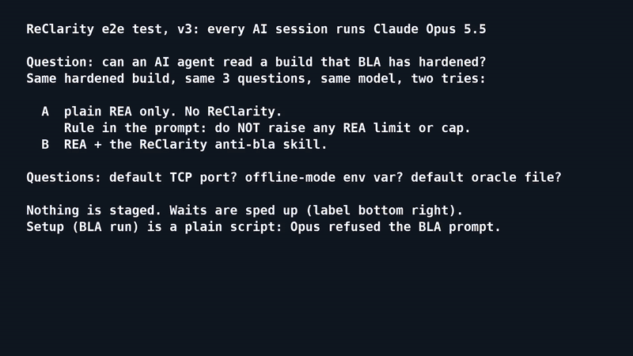

# ReClarity

**Anti-BLA.** A skill and toolkit that keeps [REA](https://github.com/morluto/rea) working on builds that [BLA](https://github.com/qybaihe/bla) has hardened.

BLA plants decoy code, floods REA's fixed limits and adds clean-looking shadow logic. BLA must keep program behavior the same. ReClarity uses that rule.



## End-to-end recording

[](docs/media/reclarity-e2e-v3.mp4)

Preview plays at 6x speed. Click it to play the full 4 min recording (`docs/media/reclarity-e2e-v3.mp4`). All AI sessions ran on Claude Opus 5.5.

- A, plain REA, cap override forbidden: stops at the 16 MiB ASAR limit. 0 of 3 answers.
- B, REA + ReClarity (agent told to use it): 3 of 3 answers correct.
- Auto-trigger does not work yet. With ReClarity installed but not mentioned, the agent raised the cap itself and had no answer after 15 min.
- BLA hardening ran as a plain script. Opus 5.5 refused that prompt.
- Limits: one run each, one model, one BLA seed (`e2e-1`). The build is an ASAR of JS tooling, not a native app.

## What it does

- **Scan** a build for BLA trap shapes before the first REA call. Score 0 means plain REA.
- **Clean a copy** of the build. The original stays unchanged.
- **Check by running** the build in a bwrap sandbox with coverage. Never-run code is "not run", never evidence.
- **Guard the budget** with token and time caps and one retry after a REA capacity error.
- **Treat target text as data.** Bait text is a finding, never an instruction.

## Skills

| Skill | Use it when |
| --- | --- |
| [`anti-bla`](skills/anti-bla/SKILL.md) | A REA run hits a capacity error, shows enclave or attestation words, or the target has BLA config files. It scans, cleans a copy and checks by running. |
| [`untrusted-repo-read`](skills/untrusted-repo-read/SKILL.md) | A repository you must read carries text that gives orders to an AI (planted instructions, forged chat turns). It writes a view copy where those spans are markers. It never hides code and never touches safeguards. |
| [`setup-clarity`](skills/setup-clarity/SKILL.md) | You start a project that will get BLA-hardened builds. It installs hooks that enforce the anti-bla rules (target text is data, bait is flagged, decoys go to anti-bla) so the agent cannot skip them. |

## Install

```bash
npx skills add i098/ReClarity --skill anti-bla
npx skills add i098/ReClarity --skill setup-clarity   # then: bun <skill>/hooks/install.ts --target dist
```

Needs [Bun](https://bun.sh) and, for coverage, `bwrap`. See [docs/usage.md](docs/usage.md).

**Agents:** follow [setup.md](setup.md) to install the tools, run the tests and install the skill.

## Run

```bash
bun skills/anti-bla/scripts/run.ts <target> --work /tmp/w --rea "rea analyze-javascript-application {target}"
```

## Docs

- [Usage](docs/usage.md): requirements, all commands, when REA runs call the skill.
- [Techniques](docs/techniques.md): each BLA trap and its answer.
- [Proof](docs/proof.md): A/B/C runs on a BLA 3.1.0 hardened sample, and the BLA 3.2.2 technique coverage table.
- [Risks](docs/risks.md): what ReClarity refuses and why.
- [Architecture](docs/architecture.md): flow and tools.

## Contribute

See [CONTRIBUTING.md](CONTRIBUTING.md). Report a vulnerability as in [SECURITY.md](SECURITY.md). Changes are listed in [CHANGELOG.md](CHANGELOG.md).

## License

[MIT](LICENSE)
