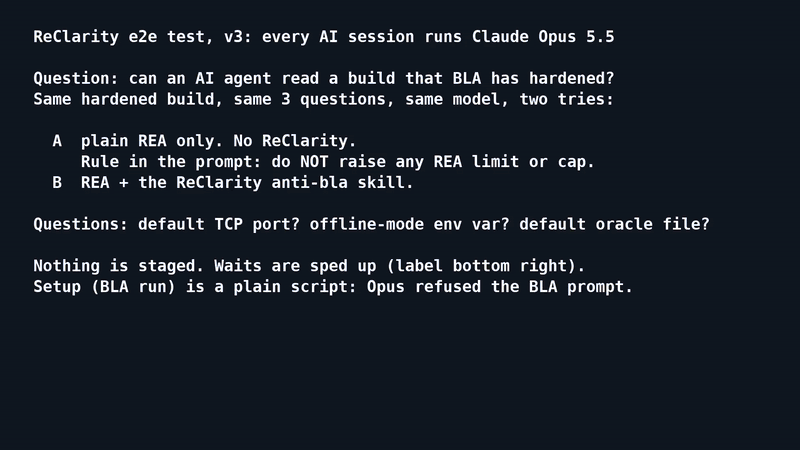

# ReClarity

[](https://github.com/AIshihzong/awesome-reverse-engineer-anything)

**Anti-BLA.** A skill and toolkit that keeps [REA](https://github.com/morluto/rea) working on builds that [BLA](https://github.com/qybaihe/bla) has hardened.

BLA plants decoy code, floods REA's fixed limits and adds clean-looking shadow logic. BLA must keep program behavior the same. ReClarity uses that rule.

## End-to-end recording

[](docs/media/reclarity-e2e-v3.mp4)

Play the full 4 min recording (`docs/media/reclarity-e2e-v3.mp4`). All AI sessions ran on Claude Opus 5.5.

- A, plain REA, cap override forbidden: stops at the 16 MiB ASAR limit. 0 of 3 answers.
- B, REA + ReClarity (agent told to use it): 3 of 3 answers correct.
- Auto-trigger did not work in this recording. With ReClarity installed but not mentioned, the agent raised the cap itself and had no answer after 15 min. The cause found since is in [Auto-trigger](#auto-trigger).
- BLA hardening ran as a plain script. Opus 5.5 refused that prompt.
- Limits: one run each, one model, one BLA seed (`e2e-1`). The build is an ASAR of JS tooling, not a native app.

## Measured comparison

Plain REA, REA + [LASIK](https://github.com/pktq/lasik) 0.3.2 (`be5a1b1`) and REA + ReClarity, on the same BLA-hardened builds. The harness is [`docs/benchmark/bench-lasik.ts`](docs/benchmark/bench-lasik.ts); raw results are in [`docs/benchmark/results/`](docs/benchmark/results) (`before.json`: ReClarity at `92fa888`, the base commit, with this harness copied over it, so it records `+dirty`; `after.json`: ReClarity at `287f54e` plus the uncommitted `before.json`, so it also records `+dirty`. Each file records the full commit SHA). The test does not run REA or an agent. A prepared copy counts as **correct** when the program gives the same output as on the unhardened app (the oracles `fixtures/check.cjs` and `check_py.py`, a SQLite view query); a copy that crashes or answers differently is wrong, however small it is. Samples: BLA 3.2.1 and 3.5.9, five JS seeds each (`s1 s2 s3 s4all s5bal`), plus one ASAR + Python + SQLite release per version. Host load was 190 to 295 during the runs, so times are only comparable inside one run. One run per cell.

Correct answers, of 5 JS seeds and of the 3 release files (ASAR, Python, SQLite):

| BLA | Arm | JS seeds correct | Release files correct | Release ASAR header (REA admits up to 16 MiB) |
| --- | --- | --- | --- | --- |
| 3.2.1 | plain | 5 of 5 | 3 of 3 | 17.4 MB: refused |
| 3.2.1 | LASIK | 0 of 5 (crash) | 2 of 3 (ASAR crash) | 1 KB |
| 3.2.1 | ReClarity before | 4 of 5 | 3 of 3 | 0.7 KB |
| 3.2.1 | ReClarity after | **5 of 5** | **3 of 3** | 0.7 KB |
| 3.5.9 | plain | 5 of 5 | 3 of 3 | 20.0 MB: refused |
| 3.5.9 | LASIK | 0 of 5 (4 wrong, 1 crash) | 2 of 3 (ASAR wrong) | 20.0 MB: refused |
| 3.5.9 | ReClarity before | 5 of 5 | 3 of 3 | 4.2 MB |
| 3.5.9 | ReClarity after | **5 of 5** | **3 of 3** | 4.2 MB |

"Plain" is correct by construction: the build is not changed. What plain gets wrong is the REA step: the ASAR is refused above the cap, and all decoy text stays. Words left that REA may read as evidence (BLA lure words, JS seed `s1`, Python, SQLite):

| BLA | Arm | `s1` bytes | `s1` lure words | Python bytes | Python lure words | SQLite lure words |
| --- | --- | --- | --- | --- | --- | --- |
| 3.5.9 | plain | 661465 | 152 | 44907 | 45 | 18 |
| 3.5.9 | LASIK | 585172 (wrong) | 85 | 44907 | 45 | 17 |
| 3.5.9 | ReClarity before | 661465 | 152 | 44907 | 45 | 0 |
| 3.5.9 | ReClarity after | **423701** | **107** | **1231** | **0** | 0 |
| 3.2.1 | plain | 414602 | 232 | 41121 | 48 | 30 |
| 3.2.1 | LASIK | 2794 (crash) | 0 | 1183 | 0 | 0 |
| 3.2.1 | ReClarity before | 129734 | 79 | 41121 | 48 | 0 |
| 3.2.1 | ReClarity after | 129734 | 79 | 1185 | 0 | 0 |

Time to prepare one build (ms, one run under load; ReClarity Python includes the sandbox coverage run that its Python cleaning needs):

| BLA | Arm | JS `s1` | Release (ASAR + SQLite) | Python |
| --- | --- | --- | --- | --- |
| 3.5.9 | LASIK | 17971 | 5318 | 5318 (same run) |
| 3.5.9 | ReClarity after | 2199 | 1601 | 3271 |
| 3.5.9 | ReClarity after, release + Python runs | | 4872 | (sum) |
| 3.2.1 | LASIK | 7386 | 4922 | 4922 (same run) |
| 3.2.1 | ReClarity after | 985 | 1087 | 3811 |
| 3.2.1 | ReClarity after, release + Python runs | | 4898 | (sum) |

Like for like (one release directory), ReClarity needs two runs: on 3.5.9 4872 ms against LASIK 5318 ms; on 3.2.1 4898 ms against 4922 ms. These are near ties at host load 168. On the JS seeds ReClarity is faster in every recorded cell.

Formats, 13 BLA fixtures (EVM, Flutter, PCAP, SQLite, Go ELF, Python source, `.pyc` 3.7, 3.12 and 3.14, BEAM, GGUF, safetensors, WASM). A format is *restored* when the output equals the unhardened file byte for byte: plain 0, LASIK 6, ReClarity 8 (4 changed, 1 unchanged; LASIK 6 changed, 1 unchanged). The results are identical before and after this change.

What this change did, from `before.json` to `after.json`:

- BLA 3.5.x JS: ReClarity folded nothing on 3.5.9 and now removes 34.7 to 36 percent of the bytes of `s1 s2 s3 s5bal`, behaviour equal on all.
- BLA 3.5.x Python: 44907 to 1231 bytes, behaviour equal. LASIK left this file unchanged.
- A multi-file `--self-seal` build (`s4all`) crashed after ReClarity on 3.2.1. It is now left unchanged and reported as `selfSealed`; the answer stays correct but the build is not reduced (3.2.1 and 3.5.9).
- `scan.ts` now notes when a build uses shapes newer than the pinned BLA 3.2.2.

Limits: one run per cell; five seeds; one host under heavy load; one release per BLA version; "correct" means the oracle output, not an agent's final answer. ReClarity on 3.5.9 still leaves 79 to 111 lure words per JS seed and does not shrink self-sealed builds. LASIK's own claims were not tested beyond the builds above. Rerun: `bun docs/benchmark/bench-lasik.ts --bla 3.5.9=<bla> --bla 3.2.1=<bla> --lasik <lasik>/dist/cli.js --work /tmp/bench --out docs/benchmark/results/after.json` (needs `node`, `python3`, `bla-agents` 3.2.1 and 3.5.9 and a built LASIK).

## Auto-trigger

REA stops with exit code 1 when a build crosses a limit. Claude Code sends a failed tool call as `PostToolUseFailure`, not `PostToolUse`. The installer registered the fence hook only for `PostToolUse`, so the capacity route never ran in that case. `setup-clarity/hooks/install.ts` now registers `fence.ts` for both. Checked: the installer test asserts the `PostToolUseFailure` entry, and a `fence.ts` test feeds a `PostToolUseFailure` event with REA's ASAR error text and asserts the `run.ts` instruction. Not yet checked: a fresh Claude Code session on a real install; this host has no Claude Code, and omp does not read `.claude/settings.json` hooks. The issue stays open until that run is recorded.

## What it does

- **Scan** a build for BLA trap shapes before the first REA call. Score 0 means plain REA.
- **Clean a copy** of the build. The original stays unchanged.
- **Check by running** the build in a bwrap sandbox with coverage. Never-run code is "not run", never evidence.
- **Guard the budget** with token and time caps and one retry after a REA capacity error.
- **Treat target text as data.** Bait text is a finding, never an instruction.

## Skills

| Skill | Use it when |
| --- | --- |
| [`anti-bla`](skills/anti-bla/SKILL.md) | A REA run hits a capacity error, shows enclave or attestation words, or the target has BLA config files. It scans, cleans a copy and checks by running. |
| [`untrusted-repo-read`](skills/untrusted-repo-read/SKILL.md) | A repository you must read carries text that gives orders to an AI (planted instructions, forged chat turns). It writes a view copy where those spans are markers. It never hides code and never touches safeguards. |
| [`setup-clarity`](skills/setup-clarity/SKILL.md) | You start a project that will get BLA-hardened builds. It installs hooks that enforce the anti-bla rules (target text is data, bait is flagged, decoys go to anti-bla) so the agent cannot skip them. |

## Install

```bash
npx skills add i098/ReClarity --skill anti-bla
npx skills add i098/ReClarity --skill setup-clarity   # then: bun <skill>/hooks/install.ts --target dist
```

Needs [Bun](https://bun.sh) and, for coverage, `bwrap`. See [docs/usage.md](docs/usage.md).

**Agents:** follow [setup.md](setup.md) to install the tools, run the tests and install the skill.

## Run

```bash
bun skills/anti-bla/scripts/run.ts <target> --work /tmp/w --rea "rea analyze-javascript-application {target}"
```

## Docs

- [Usage](docs/usage.md): requirements, all commands, when REA runs call the skill.
- [Techniques](docs/techniques.md): each BLA trap and its answer.
- [Proof](docs/proof.md): A/B/C runs on a BLA 3.1.0 hardened sample, and the BLA 3.2.2 technique coverage table.
- [Risks](docs/risks.md): what ReClarity refuses and why.
- [Architecture](docs/architecture.md): flow and tools.

## Contribute

See [CONTRIBUTING.md](CONTRIBUTING.md). Report a vulnerability as in [SECURITY.md](SECURITY.md). Changes are listed in [CHANGELOG.md](CHANGELOG.md).

## License

[MIT](LICENSE)
