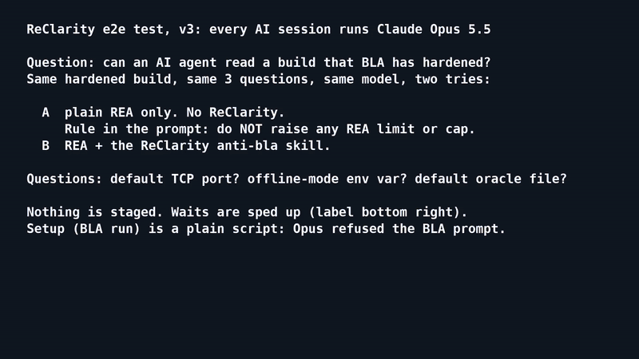

# End-to-end recording

Play the full 4 min recording (`docs/media/reclarity-e2e-v3.mp4`). All AI sessions ran on Claude Opus 5.5.

- A, plain REA, cap override forbidden: stops at the 16 MiB ASAR limit. 0 of 3 answers.
- B, REA + ReClarity (agent told to use it): 3 of 3 answers correct.
- Auto-trigger did not work in this recording. With ReClarity installed but not mentioned, the agent raised the cap itself and had no answer after 15 min. The cause and the live re-check are in [Auto-trigger](auto-trigger.md).
- BLA hardening ran as a plain script. Opus 5.5 refused that prompt.
- Limits: one run each, one model, one BLA seed (`e2e-1`). The build is an ASAR of JS tooling, not a native app.
