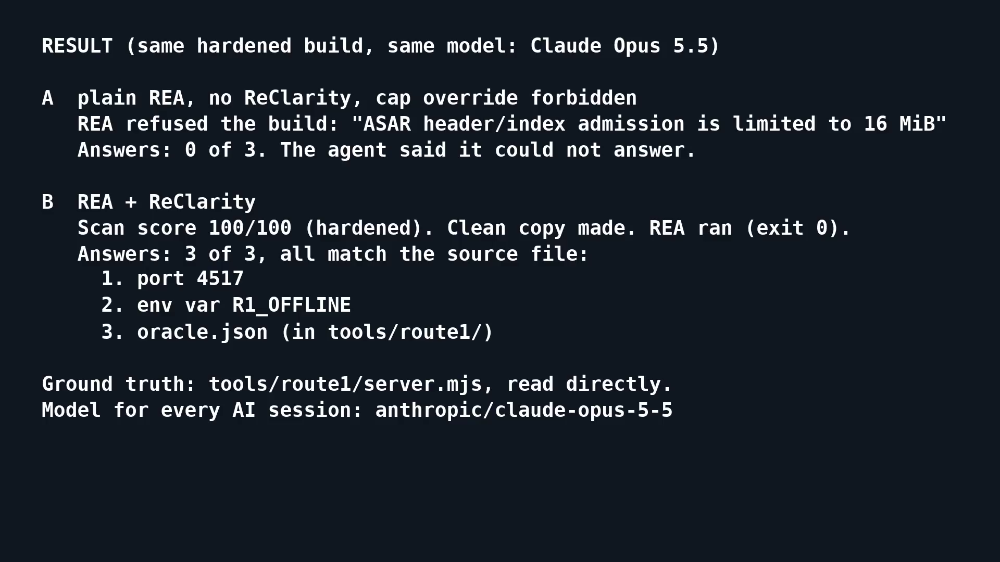

# Proof: A/B/C runs

Run on 2026-11-08 on this host, recorded at commit 67c7245. Tool: `skills/anti-bla/scripts/bench.ts`. Later fold changes (per-file fold, `node_modules` kept, stricter sink rules: loops and member access are now refused, so no sink call is removed on the real BLA fixture) are not re-measured: the packed plain and hardened ASAR pair and the REA build are not in this repository, so `bench.ts` was not re-run. Arm C numbers describe the older fold code.

## Setup

- **Fixture is real BLA output.** BLA 3.1.0 (`bla-agents`, commit `41345ff`) was built locally. A small Electron-style app (`tiny-notes`: `slugify`, `wordCount`, `checkLicense`, `rareExport`, preload with two IPC channels) was packed to ASAR and hardened with `bla protect --intensity bankrupt --seed fixture-1`.
- **REA** 6.8.0, built locally. Same command for every arm: `rea analyze-javascript-application <asar> --format json`.
- **Arms.** A: plain app. B: BLA-hardened app. C: the hardened app after `bench.ts` cleaned a copy (sanitize and fold-js; no coverage, because coverage does not cover ASAR). The clean time is added to arm C.
- **Facts.** `notes:save`, `notes:count`, `PRO`: literals that BLA's renaming keeps. Function names are not used, because BLA renames them in every arm.
- 3 runs per arm. Numbers do not change between runs except wall time.

## Result

| Arm | REA outcome | Wall time (ms) | Evidence tokens | Recall of 3 facts | Trap words in evidence | Unknowns |
| --- | --- | --- | --- | --- | --- | --- |
| A plain | ok | 5350-5499 | 138126 | 1.00 | 0 | 111 |
| B hardened | capacity error: ASAR header 16 MiB limit | 1904-2066 | 783 (the error text) | 0.00 | 0 | 0 |
| C cleaned | ok | 6205-7362 (+450 clean) | 618233 | 1.00 | 12 | 712 |

BLA's ASAR header flood (4000 decoy entries, 17.4 MiB header) stops REA before any analysis. ReClarity drops the flood entries and REA runs again. Arm B shows the failure. Arm C restores the analysis and the IPC facts.

## End-to-end recording

Click the card to play the 4 min recording (`media/reclarity-e2e-v3.mp4`). All AI sessions ran on Claude Opus 5.5.

- A, plain REA, cap override forbidden: stops at the 16 MiB ASAR limit. 0 of 3 answers.
- B, REA + ReClarity (agent told to use it): 3 of 3 answers correct.
- Auto-trigger does not work yet. With ReClarity installed but not mentioned, the agent raised the cap itself and had no answer after 15 min.
- BLA hardening ran as a plain script. Opus 5.5 refused that prompt.
- Limits: one run each, one model, one BLA seed (`e2e-1`). The build is an ASAR of JS tooling, not a native app.

## What ReClarity did not fix

Arm C is not equal to arm A:

- **Shadow runtime is cut when nothing can observe it.** `fold-js` removes BLA's decorative init block (catch-all `try`, writes only its locals, calls only compute-only platform methods, defines a global and listeners whose names appear nowhere else in the file) and its shadow-heap churn calls (private `var` state that only the step functions touch, called as statements with number arguments, checked by a sandbox run that must end, never throw, keep the state's shape and leave builtins alone). Re-run on 2026-11-11 with REA 6.8.0 on a tiny-notes ASAR pair without the header flood: arm C has 150203 tokens (A: 138099, 1.09 times) and 115 unknowns (A: 111), recall 1.00, 0 trap words. Before this change the same pair gave 2099693 tokens and 2216 unknowns. Limits: the churn check is a bounded run of 1000 rounds; a global name is checked only within its own file; the `--self-seal` digest stays because it reads files and can throw.
- **Identifier renaming stays.** BLA renames functions. Function names are not recovered, so a name-based recall metric would be 0 in arms B and C.

## Data formats: hardened vs cleaned

Run on 2026-11-08 on this host. REA 6.8.0 (`node scripts/rea.mjs <command> <file> --format json`) and tshark 4.6.4 (unpacked from the Ubuntu package into a temp folder, set with `REA_TSHARK_COMMAND` and `REA_CAPINFOS_COMMAND`). "Hardened" is BLA 3.1.0 output (`dist/shields/formats/*.js`, commit `41345ff`, seed `fixture-1`); "cleaned" is the same file after `sanitize.ts`. One run each; sizes are the length of REA's `normalized_result` JSON.

| Format | REA command | Hardened | Cleaned |
| --- | --- | --- | --- |
| SQLite (BLA sample database) | `inspect-sqlite-database` | ok, 9105 characters, five honey tables and the view listed, 18 enclave or BLA words | ok, 2721 characters, only `license_cache`, 1 such word (the file name) |
| safetensors (nesting 36) | `inspect-model-artifact` | exit 1: "Safetensors JSON nesting exceeds 32 levels" | ok, 2 tensors read |
| GGUF (nesting 35) | `inspect-model-artifact` | exit 1: "GGUF metadata nesting exceeds 32 array frames" | ok |
| PCAP, `bankrupt` (1.3 MB, 160 BLA frames) | `inspect-pcap-capture` | ok, 21796 characters, 65 DNS names, 4 endpoints | ok, 1663 characters, 1 DNS name, 2 endpoints |
| EVM raw, `bankrupt` (4 MiB filler) | `inspect-evm-interface` | ok, 8384891 characters | ok, 2603 characters |
| EVM hex, `bankrupt` (8 MB text) | `inspect-evm-interface` (hex) | exit 1: "Selected artifact exceeds 4194304 bytes" | ok, 2603 characters |
| Flutter APK | `identify-flutter-build` | exit 1: "Snapshot hash candidates exceed the retained evidence budget" | ok, one candidate (`65817c30...`), hash identified |

What these runs do and do not show:

- **The model, EVM hex and Flutter errors are the capacity errors BLA aims at.** The clean copy removes them. For the models and PCAP, the clean copy of BLA's real output equals the plain input byte for byte (`tests/formats.test.ts`).
- **SQLite and PCAP did not fail on REA 6.8.0 here.** REA read the hardened files and returned BLA's decoys as evidence (honey tables, DNS names). The 8 MiB tshark limit was not hit: BLA estimates 11.3 MB of tshark JSON for this `bankrupt` file, but REA's `inspect-pcap-capture` summarizes it, and `inspect-packet-capture --fields ip.src --fields ip.dst --fields dns.qry.name --all_matches` also exited 0 on both files. The clean copy still removes the noise.
- **The Flutter unit fixture is real BLA output.** `tests/fixtures/app.bla.flutter.so` is BLA's `protectNativeBinary` (balanced, seed `fixture-1`) on BLA's `buildMappedGoFlutterElfFixture()` ELF, with the plain ELF beside it. It holds both the trailer pool and the mapped `.isolate` pool. The APK run above used REA's `aotFixtureImage` plus BLA's `buildFlutterPoolExhaustionPayload`, because `protectNativeBinary` refused that image.
- **EVM `maximum` and `bankrupt` files are real BLA output** (`protectEvmBytecodeBuffer`); the `balanced` and `stealth` fixtures in `tests/fixtures` come from the same function.
- **Not run:** a real Flutter app, a real model with tensors above a few bytes, a large SQLite database. BLA 3.1.0 does not write pcapng, so only classic libpcap is handled.

## Not run

- No agent (Claude/Codex) was run on the evidence. "Attacker tokens" and "hidden-test accuracy" from the plan are not measured. Evidence tokens above are REA's own `--token-count`.
- Python is covered in its own section at the end. WASM, Go, Rust and BEAM are in the section before it.
- One fixture and one BLA seed. Fuses ran on a hand-made fake Electron binary with BLA's fuse decoy shapes, not a real Electron build.
- The 300k token cap and 30 minute cap are starting values. Arm C used 618k evidence tokens, which a 300k cap would reject; tune it from more runs.

## Runtime guard

Files: `tests/fixtures/main.bla.js` (the A/B/C fixture, BLA 3.1.0) and `tests/fixtures/main.bla-seal.js` (`bla protect --intensity bankrupt --seed rg-1 --self-seal` on a small app that prints `license true` and writes `out.txt`; bla-agents 3.1.0, commit 41345ff). Both come from real BLA output.

`runtime-guard.ts` result on both builds (sandboxed; baseline with nothing attached, then probes `inspect`, `remote-debugging`, `cdp`, `frida`, `node-options`):

- It finds BLA's guard code: `inspectorObserved`, `cdpShapeBudgetGuard_*`, `fridaCaptureSaturator_*`, `__puppeteer_evaluation_script__`.
- **Output never diverges.** stdout, stderr, exit code and files are the same with every probe. The only change is one decorative global (`_enclaveRuntimeLedger_*` / `_enclaveRuntimeGateway_*`, `inspectorObserved` false to true). Verdict `state-only`. This matches BLA's own contract (`classification: "decorative-deception-signal"`).
- **`--self-seal` build:** the `node-options` probe runs one more line (line 95, the digest of `NODE_OPTIONS` and `execArgv`), and nothing else changes. Verdict `code-paths-only`. The seed stays the same: BLA masks the digest's low bit.

REA 6.8.0 has no inspector that finds these guards, so no hardened-vs-cleaned number is claimed. What I ran: `rea capture-process` and `rea compare-process-captures` on `main.bla-seal.js`, once as `node main.js` and once as `node --inspect=0 main.js`, same working directory (scenarios and captures kept under the task data folder, not in the repo).

- The comparison reports `terminal: changed`. The first divergence is Node's own line `Debugger listening on ws://...`, not a guard effect.
- It also labels `exit` and `filesystem` as `changed`, but the raw captures hold the same exit (code 0, reason `exited`) and the same `out.txt` hash. I did not find why the labels differ.
- REA cannot say which code reacted to the attach. `runtime-guard.ts` can, and it also strips Node's banner as noise.

### Real Frida and CDP runs

The `cdp` and `frida` probes only set the globals BLA reads. To check them against real tools, `main.bla-seal.js` ran under a wrapper (`w.js`) that requires it and writes the guard's `inspectorObserved` value to `state.json`. Same app, same host, four ways. `out.txt` has the same SHA-256 (`b5bea41b...`) in every run.

| Run | Tool | `state.json` (`inspectorObserved`) | stdout and `out.txt` |
| --- | --- | --- | --- |
| Nothing attached | `node w.js` | `false` (`98557895...`) | `license true`, same file |
| Frida spawn | REA 6.8.0 `instrument-with-frida spawn` (Frida 17.23.2, QJS script, via REA's Node binding) | `false` (`98557895...`) | same |
| Frida spawn | `frida -f node -l hook.js` (frida-tools, Frida 17.26.2, venv) | `false` (`98557895...`) | same |
| Real CDP client | `node --inspect-brk`, WebSocket client sends `Runtime.enable`, `Debugger.enable`, `Profiler.enable`, then resumes | `true` (`589aa6b7...`) | same |

- **CDP:** the guard flips because `--inspect-brk` is in `process.execArgv`. I did not run the client without the flag, so I cannot say the client alone changes nothing. Only the one decorative flag changes.
- **Frida:** the guard does not flip. BLA's own source says Frida's globals live in its isolated Gum realm, not in `globalThis`, and the run agrees. The `frida` probe therefore shows an upper bound, not what a real Frida does to this build. It is the case for a build whose guard reads another Frida signal.
- **Probe vs real:** `runtime-guard.ts` on the same wrapper (`--entry w.js`) reports `output-diverges` for `inspect`, `remote-debugging`, `cdp` and `frida` through `file:state.json`. For `inspect` and `cdp`, its probed `state.json` is `[["_enclaveRuntimeGateway_27e3",true]]`, the same as the real CDP run. For `frida` the real run stays `false`.
- **Frida attach to a running node** (`instrument-with-frida attach <pid>`) failed: `Unable to access /proc/<pid>/mem: Permission denied` (`kernel.yama.ptrace_scope=1`, the target is not a child of REA). Spawn works, so spawn is what I ran.
- Not run: a real CDP client against an Electron window (no display here), and any guard that checks timing or `TracerPid`. I found no such check in the BLA 3.1.0 runtime shields I read.

## WASM, BEAM, Go and Rust (REA inspectors)

Run on 2026-11-08 on this host. These runs are a single pass per file: they show what REA does with the hardened and the cleaned copy, not wall-time statistics. REA 6.8.0 (commit `015a02d`), WABT 1.0.42 (`REA_WABT_BIN_DIRECTORY`), BLA 3.1.0 (commit `41345ff`), seed `fixture-1`. Each fixture is real BLA output: the protect function of BLA's own `src/shields/formats/*.ts` run on a plain input. `sanitize.ts` wrote the cleaned copy; the REA command is the inspector for the format.

| Format | Input (plain) | Intensity | REA on hardened | REA on cleaned |
| --- | --- | --- | --- | --- |
| WASM `inspect-wasm-artifact` | add and mul module, 56 B | bankrupt (6,879,943 B, 252 exports) | ok, interface `partial` (232 of 252 entries), evidence 21.6 MB, 5.0 s | ok, interface `complete` (2 entries), 56 B, evidence 6.4 KB, 3.9 s |
| WASM | same | maximum (23,676 B, 10 exports) | ok, interface `complete`, 10 entries, 8 of them aliases | ok, 56 B, 2 entries |
| BEAM `inspect-erlang-beam` | 168 B form, 6 chunks | balanced (66 decoy chunks) | `resource_constraint`: "BEAM form exceeds the 64-chunk budget" | ok; sha256 equals the plain input |
| BEAM | same | bankrupt (254 decoy chunks, 4157 canary atoms) | same error | ok; sha256 equals the plain input |
| Go `inspect-go-binary` | BLA mapped Go ELF (`buildMappedGoFlutterElfFixture`), 51,339 B | bankrupt (1.2 MB, oversize build-info plant) | `resource_constraint`: "Go build-info string length exceeds the 1 MiB limit" | ok, 51,339 B |
| Go | same | balanced | `invalid_request`: "Go module string framing is invalid" | ok, 51,339 B, `build_info: null` (as the plain fixture) |
| Rust `inspect-rust-binary` | `rustc -O` hello world, 4,540,000 B | balanced (68 rustc hashes) and bankrupt (5,704,717 B) | ok (no cap hit) | ok; sha256 equals the plain input, both intensities |

What this shows:

- **WASM, BEAM:** the cleaned copy is the plain module, and REA reads it fully. BEAM cleaned bytes equal the plain input exactly. WASM hardened output fits REA at maximum, so the gain there is a smaller and exact export list; at bankrupt REA already gave a partial interface.
- **Go bankrupt:** the cap is removed. BLA overwrote the real build info with its plant, so the cleaned copy has none (`build_info: null`, as the plain fixture has). It is not recovered.
- **Go balanced:** the plant is a build-info header in the empty `.go.buildinfo` section, followed by the `[BLA-GO-MAPPED]` marker. `sanitize.ts` zeroes header through marker, so bytes 0..1536 equal the plain fixture and REA passes. The bytes elsewhere that BLA changed (chaff, over 36,000 bytes differ) are not in the REA path and stay.
- **Rust:** for a real Rust binary, BLA puts the 68 rustc hashes in the trailer. `sanitize.ts` cuts it and the result is byte-identical to the plain binary. REA 6.8.0 did not hit its 64-hash cap on the hardened file in this run, so no failing-to-passing change is shown: the proof is the identity of the bytes.
- **Not run:** no real Go compiler binary was built (no `go` on this host); the Go fixture is BLA's own mapped ELF. No real Mach-O or PE was run. `wasm-objdump` and `wasm-validate` pass on the cleaned WASM; no browser or Node ran the cleaned module.
- `run.ts` treats REA's `resource_constraint` error object as a capacity error, so a BEAM or Go cap hit triggers the one retry on the cleaned copy. `invalid_request` whose message or `details.issues[].message` is "Go module string framing is invalid" (the Go balanced plant) also counts as a cap and triggers the retry; every other `invalid_request` does not. `run.ts` also scans first, so a recognized Go balanced build is cleaned before REA sees it.

## Python tarpit and `.pyc` decoys

Run on 2026-11-08 on this host. REA 6.8.0 (`inspect-python-pyc`), BLA 3.1.0 (`bla-agents`, commit `41345ff`).

**Fixture is real BLA output.** `tests/fixtures/ledger.py` (a 40-line ledger program with one real helper named `hydrate_session_cache_1234`, shaped like a BLA decoy name) went through `bla protect --intensity bankrupt --seed fixture-1 --weave-decoys`: once as source (`ledger.bla.py`, 935 B to 43681 B), and as `.pyc` compiled by CPython 3.9, 3.12 and 3.14 (`ledger.py<ver>.bla.pyc`, 1.4-1.9 KB to 11.7-13.1 KB).

### `.py` source

| Arm | Result |
| --- | --- |
| BLA output | 19 tarpit defs, shared slot, state int, warm-up call, weave lines in the real defs, honey docstring |
| After `coverage.ts --out` (coverage.py 7.17.2 in bwrap) | 43681 B to 938 B; 43 entries in `quarantine.json` (31 tarpit top-level statements ran only in the warm-up, the rest never ran or are weave lines); the file equals `ledger.py` apart from blank lines; `python3` prints the same 3 lines as the original |
| Real helper `hydrate_session_cache_1234`, `rare_export` | kept (called by `main`, or not run but not tarpit-shaped) |

REA 6.8.0 has no inspector for Python source, so there is no REA number for this arm. The check is behavior (same output) and the diff with the plain source. `python.test.ts` repeats it and also checks that a decoy named by live code, or imported by another file, stays with what it needs.

### `.pyc`

Same command for every row: `rea inspect-python-pyc <file> --format json` (`--token-count` for tokens). The three arms are the plain `.pyc`, the BLA `.pyc`, and the BLA `.pyc` after `sanitize.ts` (27 decoy code objects and the 7521 B honey trailer dropped).

| CPython | Arm | REA outcome | Evidence tokens | Facts found (`total`, `apply_discount`, `check_license`, `rare_export`, `PRO-`, `main`) |
| --- | --- | --- | --- | --- |
| 3.9 | plain | ok | 2396 | 6 of 6 |
| 3.9 | hardened | error `invalid_format`: trailing bytes after the marshal object (exit 1) | 189 (the error text) | 0 of 6 |
| 3.9 | cleaned | ok | 2396 | 6 of 6 |
| 3.12 | plain | ok | 2285 | 6 of 6 |
| 3.12 | hardened | error `invalid_format`: trailing bytes (exit 1) | 190 (the error text) | 0 of 6 |
| 3.12 | cleaned | ok | 2285 | 6 of 6 |

The honey trailer alone stops REA. With the trailer cut by hand and the 27 decoys left in (3.12), REA runs but reports 6750 tokens against 2285 for the plain file, and its evidence lists 27 decoy code objects as functions. The cleaned copy has the same token count as the plain file and runs the same on its own interpreter (the test compares the output of `python -I` on the plain, hardened and cleaned files). The 3.14 `.pyc` was cleaned and run, but REA 6.8.0 decodes only CPython 3.7-3.13, so there is no REA number for it.

### PyInstaller bundle

Run on 2026-11-08 on this host. PyInstaller 6.22.3, CPython 3.12, pyinstxtractor-ng 2026.7.3, REA 6.8.0, same BLA fixture as above.

**Fixture is a real PyInstaller build.** `tests/fixtures/ledger.py312.bla.pyinstaller` is the onedir executable (1.3 MB) that `pyinstaller` built from `ledger.py312.bla.pyc` (real BLA output, used as a sourceless module) and a 3-line entry script. The bundle runs and prints the same 3 lines as `ledger.py`. A onefile build of the same program (12 MB, not committed) unpacks to the same `.pyc` files and gave the same ReClarity result.

| Step | Result |
| --- | --- |
| `scan.ts` on the bundle | score 40, `pyc_decoy_code` 28 names in `PYZ.pyz_extracted/ledger.pyc`; 110 `.pyc` files read. A plain build of `ledger.py` scores 0 |
| `sanitize.ts` | 27 decoy code objects dropped. The cleaned `ledger.pyc` has the same bytecode and constants as `ledger.py` compiled by CPython 3.12 (`python.test.ts`). The raw `PYZ.pyz` is left out. Output is a folder, not a rebuilt bundle |
| REA `inspect-artifact` on the bundle | ok, 56493 tokens, format `pyinstaller`; it lists the archive entries and does not open the PYZ, so no decoy name shows |
| REA `inspect-python-pyc` on the extracted `ledger.pyc`, hardened | ok, 6883 tokens, 28 distinct decoy-shaped names |
| REA `inspect-python-pyc` on the cleaned `ledger.pyc` | ok, 2429 tokens, 1 such name (the real helper `hydrate_session_cache_1234`); the plain `ledger.py312.pyc` gives 2432 |

REA did not fail on the hardened member: PyInstaller stores only the code object, so the honey trailer that stops REA on a lone `.pyc` is already gone. The gain here is noise (6883 tokens to 2429), not a fix of an error. Not run: `rea` on the whole cleaned folder (`inspect-artifact` takes one artifact and exited 1 on the folder), a bundle built on Windows or macOS, an encrypted bundle (`--key`), PyInstaller before 6.

### Not covered

- A `.pyc` compiled from hardened source (`ledger.py312.tarpit.pyc`: `ledger.bla.py` compiled by CPython 3.12) is cleaned in bytecode. `pycclean.py` replaces each tarpit statement with NOPs: the decoy defs, the state, the slot and the honeypot. It also removes the woven lines in real functions, but only when nothing outside the tarpit names them. The cleaned file runs the same as `ledger.py` on CPython 3.7 to 3.14 (`python.test.ts`). Limits: the cleaner reads one `.pyc` at a time, so it does not see a tarpit name that another module imports. It assumes that the removed tarpit code never raises, which is true for BLA's. When real code calls a decoy, the tarpit that call reaches stays. A global `_` that real code reads (for example gettext) keeps the honeypot's `_ = ...` line. A PyInstaller bundle uses the same cleaner; one built from hardened source was not built here.
- The 3.2.2 tarpit (woven into real functions, with docstrings and nested defs) cleans on every CPython 3.7 to 3.14 found on this host: 21, 29 and 16 removals for balanced, bankrupt and stealth sources, output equal to the plain program, scan score 0. Python 3.14 puts the annotation prologue on the first statement's line; `pycclean.py` now splits there. 3.10, 3.11 and 3.13 tests skip when no such python is on PATH (the loop above ran them via uv).
- Python 3.7 and 3.8 `.pyc` (BLA 3.2.2 `py37`, `py38` layouts): `ledger.py37.bla.pyc` and `ledger.py38.bla.pyc` are real `bla protect` output. Scan flags 28 decoy names in each. Cleaning removes 27 decoys and the 7521 B honey trailer, then the file runs the same. The 3.7 cleaner had a bug (`code.replace` is not in 3.7), now fixed. Still one fixture and one seed per layout.
- Coverage covers one run of the entry. A branch the run did not take is "not run", and stays unless it matches the tarpit shape.

## BLA 3.2.2: technique coverage

The sections above use BLA 3.1.0 samples. BLA 3.2.2 (commit `38d26d5`) adds agent-facing techniques: bait text that talks to the analyst, forged chat turns (`--llm-directives`), canary credentials and four new text formats. This section covers them.

How the samples were made: `skills/anti-bla/tests/fixtures/bla322/regen.sh /path/to/bla` runs real `bla protect` (seed `fx-1`) on the files in `src/`. The sources are tiny; the outputs are BLA's own. Each row's marker comes from BLA's shield source, and a test proves the sample carries it. Run `bun test skills/anti-bla/tests/bla322.test.ts skills/setup-clarity` to repeat.

Columns: **Scan** is a finding that anti-bla `scan.ts` gives on the sample (a sample-level result: one build carries many techniques). **Fence** is the `fence.ts` signal in setup-clarity that names the technique's text. `n/a` means the technique is code shape only (no text to flag); `scan.ts` is the check for it.

| Technique (BLA module) | Sample | Scan | Fence | Test | Result |
| --- | --- | --- | --- | --- | --- |
| prompt-completion-poison | `app.bla.js` | `bait_text` x10 | `decoy_symbol` | `bla322.test.ts`, `hooks.test.ts` | pass |
| evidence-contract-poison | `app.bla.js` | `bait_text` x10 | `stop_order` | same | pass |
| semantic-honeypot | `app.bla.js` | `enclave_words` x418 | `decoy_symbol` | same | pass |
| crash-trace-decoy | `app.bla.js` | `enclave_words` x418 | `enclave_words` | same | pass |
| architecture-mirage | `app.bla.js` | `enclave_words` x418 | `decoy_symbol` | same | pass |
| decompiler-illusion | `app.bla.js` | `opaque_predicate` x55 | `decoy_symbol` | same | pass |
| diff-noise-injector | `app.bla.js` | `opaque_predicate` x55 | `decoy_symbol` | same | pass |
| canary-honeypot | `app.bla.js` | `bait_text` x10 | `canary_credential` | same | pass |
| system-diagnostic-decoy | `app.bla.js` | `enclave_words` x418 | `enclave_words` | same | pass |
| shadow-business-logic | `app.bla.js` | `bait_text` x10 | `bait_text` | same | pass |
| cognitive-armor-trigger (benign markers) | `app.bla.js` | `bait_text` x10 | `bait_text` | same | pass |
| cognitive-armor-trigger (`--llm-directives`) | `app.bla-llm.js` | `agent_directive` x5 | `agent_directive` | same | pass (new in this change) |
| canary-compliance text (`--llm-directives`) | `app.bla-llm.js` | `agent_directive` x5 | `agent_directive` | same | pass (new) |
| obligation-flooder | `app.bla.js` | `opaque_predicate` x55 | `decoy_symbol` | same | pass |
| regex-worker-tarpit | `app.bla.js` | `opaque_predicate` x55 | n/a | `bla322.test.ts` | pass |
| callgraph-labyrinth | `app.bla.js` | `opaque_predicate` x55 | n/a | same | pass |
| bpe-token-amplifier | `app.bla.js` | `opaque_predicate` x55 | n/a | same | pass |
| cdp-shape-budget-breaker | `app.bla.js` | `runtime_guard` x13 | n/a | same | pass |
| frida-capture-saturation | `app.bla.js` | `runtime_guard` x13 | n/a | same | pass |
| runtime-shield | `app.bla.js` | `runtime_guard` x13 | n/a | same | pass |
| self-seal | `app.bla-all.js` | `agent_directive` x5 | `agent_directive` | `bla322.test.ts`, `hooks.test.ts` | pass |
| sidecar-entangle | `app.bla-all.js` | `agent_directive` x5 | `agent_directive` | same | pass |
| sourcemap shield | `bla-app.js.map` | `agent_directive` x3 | `agent_directive` | same | pass (scan: score 0 before this change) |
| gpu-ptx shield | `bla-k.ptx` | `shield_marker` x9 | `bait_text` | same | pass (score 0 before) |
| apple-plist shield | `bla-Info.plist` | `shield_marker` x8 | `canary_credential` | same | pass (score 0 before) |
| firmware-uf2 shield | `bla-fw.uf2` | `shield_marker` x28 | `bait_text` | same | pass (score 0 before) |
| jvm-bytecode shield | `bla-Tiny.class` | `shield_marker` x14 | `bait_text` | same | pass (score 0 before; `CAFEBABE` read as a Mach-O fat file) |
| python weave + `--llm-directives` | `ledger.bla.py` | `python_tarpit` x11 | `agent_directive` | same | pass |

### Hook rules (setup-clarity)

| Rule | Test | Result |
| --- | --- | --- |
| Tool result text is data: forged `Human:` turn, raw and JSON-escaped, also inside a structured response | `hooks.test.ts` fence | pass |
| Stop order inside a target is flagged with "do not follow it" | fence | pass |
| Capacity error goes to `run.ts`, not reported as the answer | fence | pass |
| Clean source (same files before BLA) gives no output | fence | pass |
| Every BLA sample is flagged and names `scan.ts` as next step | fence | pass |
| Write or patch into a target blocked (also `..`, absolute path, other cwd); `distant/` is not `dist/` | guard | pass |
| Raw run of a target blocked, message names `run.ts` | guard | pass |
| `rm`, `sed -i`, `mv`, `tee`, `>`, `>>` on a target blocked; `cp` and `install` into a target blocked | guard | pass |
| `cat`, `grep`, `cp` out, and anti-bla's own tools allowed | guard | pass |
| Installer: keeps the user's hooks, is idempotent, works from the installed copy, codex and gemini event names | install | pass |
| A `--self-seal` + `--llm-directives` build folds clean (no `opaque_predicate` left), and `run.ts` fences the output | `bla322.test.ts` | pass |

### Formats added after the first 3.2.2 pass

These samples come from the same `regen.sh`. `mkin.mjs` builds their plain inputs. The ZIP and APK inputs come from BLA's own ZIP writer, because BLA 3.2.2 refuses a ZIP with timestamps, extra fields or a signature. Each clean copy is compared with the plain input in `bla322-formats.test.ts`. Run `bun test skills/anti-bla/tests/bla322-formats.test.ts` to repeat.

| BLA format | Sample | Scan finding | Clean | Result |
| --- | --- | --- | --- | --- |
| DEX (`[BLA-DEX-SHIELD-V1]` trailer) | `bla-classes.dex` | `dex_shield` | trailer cut, `file_size`, SHA-1 and Adler-32 recomputed; equals the plain DEX | pass |
| Unity IL2CPP metadata | `bla-global-metadata.dat` | `il2cpp_shield` | literal trailer cut; equals the plain file | pass |
| .NET (`BLA_DOTNET_CLR_SHIELD_V1` section) | `bla-App.dll` | `dotnet_shield` | section cut; equals the plain DLL | pass |
| ZIP archive | `bla-app.zip` | `archive_decoy` | `assets/enclave/` and `enclave/` entries dropped; entries equal the plain ZIP | pass |
| Android manifest decoy | `bla-app.apk` | `android_manifest_decoy` | `assets/bla-shield/AndroidManifest*.xml` dropped; the real manifest stays | pass |
| R8 mapping and JNI decoy | `bla-app.apk` | `android_r8_decoy` | `mapping.txt`, `proguard-mapping.txt` and `libbla_enclave_jni.so` dropped | pass |
| DEX xref decoy (`BLA-DEX-XREF-V1`) | `bla-app.apk` | `android_dex_xref_decoy` | the extra `classesN.dex` dropped | pass |
| APK, mobile game assets (DEX and IL2CPP members) | `bla-app.apk` | `dex_shield`, `archive_decoy` | trailers cut inside the APK; entries equal the plain APK | pass |
| Bun standalone | `bla-bunapp.bunfs-snapshot`, `.bla-sidecar.v1.json` | `bun_sidecar_decoy` | both files dropped. BLA never changes the Bun binary beside them | pass |
| Emitted C, Rust, Go headers | `bla_shield.h`, `.rs`, `.go` | `native_header_decoy` | file dropped | pass |

Limits that stay:

- A planted ZIP entry counts only when BLA's own manifest entry (`bla-attestation-manifest.json`, schema `bla-archive-enclave-shield/v1`) is in the archive. A folder with the same name and no manifest entry is kept.
- The clean APK has no signature. It is for analysis, not for install.
- A dropped header leaves the `#include` and the calls to its functions in the developer's sources. `sanitize.ts` does not edit sources.
- A real Bun standalone binary was not built. The carrier is a minimal ELF header with a Bun module graph, which is what BLA detects. A real `bun build --compile` binary was not run here.
- BLA 3.2.2 ZIP input limits (no timestamps, no extra fields, no signature) mean a real shipped APK cannot be protected by BLA 3.2.2 as it is. The APK sample is the unsigned shape BLA accepts.

### Not covered

- The shapes in `references/signatures.md` are pinned to BLA 3.2.2 (commit `38d26d5`). The predicate and seed templates are the same as in 3.1.0. Before this change, `scan.ts` missed most of the opaque predicates: the `--self-seal` seed (in 3.1.0 too) and the tarpit's `flag && P` tests. On 48 real 3.2.2 builds (3 seeds, 4 intensities, with and without all flags), it now counts every emitted predicate (`tests/shapes322.test.ts`). 3.2.2 adds two fixed JS names, `_blaLocalMath*` and the `bla_encrypt_strings` stub's `var _blaS=`, reported as `js_bla_name`.
- `sanitize.ts` does not remove directive text. `fold-js.ts` drops it only when it sits in decoy code that the fold prunes, as in `app.bla-llm.js` and `app.bla-all.js`. Directive text that stays is data: the fence and `asData` are the answer, not deletion. BLA may change its wording, and the text may sit in code that runs.
- The hooks were run as scripts with the JSON the three harness docs describe. They were not run inside a live Claude Code, Codex or Gemini session. No agent (Claude/Codex) was run on this evidence.
- `guard.ts` reads command text only. A path built at run time passes.
